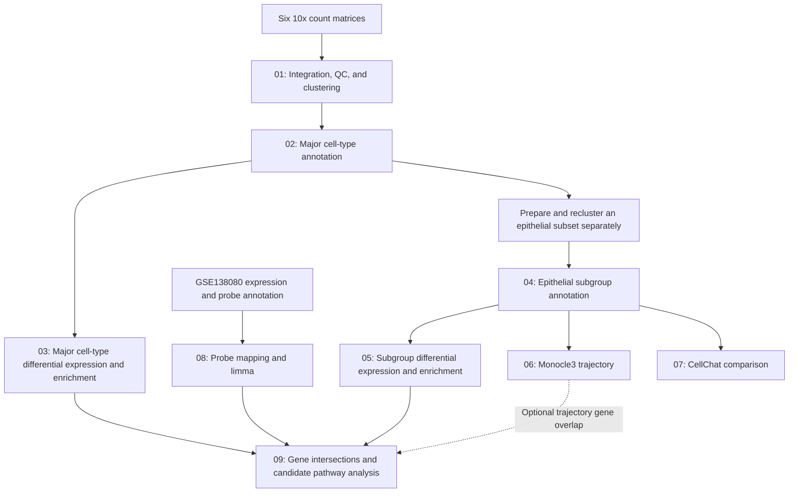

# E-MTAB-11948: Cervical Cancer Single-Cell Transcriptome Analysis

R, Bash, and Python scripts for secondary analysis of cervical cancer single-cell RNA sequencing data from **E-MTAB-11948**, with complementary analysis of the **GSE138080** tissue expression dataset.

The analysis covers sample integration, cell quality control, clustering, major cell-type and epithelial subgroup annotation, tumor-versus-normal differential expression, functional enrichment, pseudotime analysis, cell–cell communication, and candidate gene screening across datasets.

> **Before running:** this repository contains project-specific analysis scripts. Several scripts use hard-coded server paths, and the source archive does not include expression matrices, intermediate RDS objects, or all external helper scripts. Configure the paths and prepare the required inputs before executing a module. The commands below describe the supplied code; they are not an end-to-end execution validation.

## Contents

- [Data sources and sample labels](#data-sources-and-sample-labels)
- [Repository structure](#repository-structure)
- [Analysis workflow](#analysis-workflow)
- [Software dependencies](#software-dependencies)
- [Input preparation](#input-preparation)
- [Running the analysis](#running-the-analysis)
- [Parameters used in the scripts](#parameters-used-in-the-scripts)
- [Expected outputs](#expected-outputs)
- [Reproducibility notes](#reproducibility-notes)
- [Data citation and licensing](#data-citation-and-licensing)

## Data sources and sample labels

| Dataset | Role in this project | Access |
| --- | --- | --- |
| **E-MTAB-11948** | Human cervical cancer and adjacent normal tissue scRNA-seq; the integration script reads six sample directories. | [ArrayExpress / BioStudies](https://www.ebi.ac.uk/biostudies/arrayexpress/studies/E-MTAB-11948) |
| **GSE138080** | Independent tissue expression comparison using probe-to-gene mapping and limma. | [NCBI GEO](https://www.ncbi.nlm.nih.gov/geo/query/acc.cgi?acc=GSE138080) |

The E-MTAB-11948 data source is described in [*Single-cell transcriptomics reveals cellular heterogeneity and molecular stratification of cervical cancer*](https://doi.org/10.1038/s42003-022-04142-w). This repository documents a secondary analysis and should not be assumed to contain the original publication's analysis code.

The single-cell scripts use the following local sample labels:

| `Sample` | `SampleGroup` |
| --- | --- |
| `Normal_1`, `Normal_2`, `Normal_3` | `Normal` |
| `Tumor_1`, `Tumor_2`, `Tumor_3` | `Tumor` |

These labels must be mapped to the downloaded sample metadata. The scripts do not provide a mapping from the local labels to public sample accessions.

**GSE138080 is an Agilent expression microarray dataset**, as recorded by [NCBI GEO](https://www.ncbi.nlm.nih.gov/geo/query/acc.cgi?acc=GSE138080). The existing directory name `08.bulk-RNAseq analysis` is retained for consistency with the source archive. Its limma script specifies 10 normal samples followed by 10 tumor samples; prepare the corresponding expression matrix in that order. The complete GEO series also contains precancerous samples, which are outside this hard-coded two-group design.

## Repository structure

The source archive contains **72 scripts: 61 R scripts, 10 shell scripts, and 1 Python script**. Directory names are preserved below.

```text
E-MTAB-11948_scRNAseq_analysis/
├── README.md
├── 01.Data Quality Control Integrated Clustering/
├── 02.Major cell cluster annotation and proportion/
├── 03.Analysis of differences between large groups/
├── 04.Subgroup Cell Annotation and Proportion/
├── 05.Subgroup differences analysis/
├── 06.Trajectory/
├── 07.CellCellCommunication/
├── 08.bulk-RNAseq analysis/
└── 09.Screen key genes/
```

| Module | Main scripts | Purpose |
| --- | --- | --- |
| **01. Integration, QC, and clustering** | `seurat_IntegrateData.R`, `seurat_FilterCells.R`, `seurat_Cluster.R`, `seurat_FindAllMarkers.R` | Read six 10x matrices, integrate samples, filter cells, perform PCA and graph clustering, generate UMAP/t-SNE plots, and identify cluster markers. Supporting scripts plot composition and cluster correlations. |
| **02. Major cell annotation** | `seurat_rename_celltype.R`, `DotPlot.R`, `UMAP_plot.R`, `seurat_obj_meta.R`, `OR_valuea_analysis.R` | Apply predefined major cell-type labels, visualize markers and cell composition, export metadata, and assess cell-type distribution with odds ratios. |
| **03. Major cell-type differences** | `example_DiffExp.R`, `GroupDiffExpression.sh`, `GO_Enrichment.R`, `KEGG_Enrichment.R`, `GSEA_Enrichment.R`, `volcano_map.R` | Compare tumor and normal cells within a selected major cell type and perform functional enrichment. Additional scripts support expression export and limma-based exploration. |
| **04. Subgroup annotation** | `seurat_rename_celltype.R`, `seurat_FindAllMarkers.R`, `DotPlot.R`, `UMAP_plot.R`, `OR_valuea_analysis.R` | Annotate an already clustered epithelial subset and summarize subgroup markers, proportions, and distribution. |
| **05. Subgroup differences** | `example_DiffExp.R`, `GroupDiffExpression.sh`, enrichment and volcano scripts | Compare tumor and normal cells within an annotated subgroup. |
| **06. Trajectory** | `monocle3_Trajectory.R`, `trajectory.sh`, `Groups_Venn.sh`, `Gene_intersect.R` | Infer a Monocle3 trajectory, order cells in pseudotime, identify trajectory-associated genes, and compare gene sets. |
| **07. Cell communication** | `get_SampleGroup_data.R`, `diff_group_CellChat.R`, `CellChat.sh` | Split the annotated epithelial object by group and compare CellChat interaction networks, signaling pathways, and ligand–receptor pairs. |
| **08. Bulk tissue expression** | `probe2gene_matrix.R`, `limma.R`, `GroupDiffExpression.sh`, GO/KEGG scripts | Map probes to gene symbols, aggregate probe values, log-transform expression, and perform a tumor-versus-normal limma comparison. |
| **09. Candidate gene screening** | `all_groups_data.py`, `all_groups_venn.R`, `Gene_intersect.R`, `Groups_Venn.sh`, `KEGG_Enrichment.R`, `KEGG.sh` | Compare gene sets from bulk and single-cell analyses, export their intersection, and analyze candidate pathways. |

## Analysis workflow



The archive does **not** include a dedicated script that generates the reclustered epithelial object required by module 04. Prepare that object separately and review the cluster-to-cell-type mapping before continuing. Modules 06 and 07 read the annotated epithelial subgroup object.

## Software dependencies

The shell scripts reference **R 4.3.1**, **R 4.4.1**, and **Python 3.12.2** installations on the original server. These paths document the original executable choices; package versions and a complete environment specification are not supplied.

| Component | Packages or tools referenced by the code |
| --- | --- |
| Single-cell processing | `Seurat`, `dplyr`, `patchwork`, `cowplot` |
| Plotting and data handling | `ggplot2`, `ggrepel`, `ggpubr`, `corrplot`, `pheatmap`, `viridis`, `data.table`, `readr`, `plyr`, `tidyr`, `reshape2`, `tidyverse`, `stringr` |
| Command-line interfaces | `optparse` |
| Differential expression and enrichment | `limma`, `clusterProfiler`, `enrichplot`, `org.Hs.eg.db`, `pathview`, `riceidconverter` |
| Trajectory analysis | `monocle3`, `igraph` |
| Cell communication | `CellChat`, `ComplexHeatmap`; `CellChatDB.human` is used by the communication script |
| Cell distribution and gene-set plots | `sscVis`, `VennDiagram` |
| Python | `pandas`; other Python imports are from the standard library |
| Shell utilities | Bash and utilities including `awk`, `sed`, `cut`, `head`, `cat`, `cp`, and `mkdir` |

Install dependencies in an R/Python environment compatible with the selected modules. Some packages are imported even where their functions are not used, including `riceidconverter` in the supplied human enrichment scripts. Base R packages such as `grid` are not listed separately.

Use Linux or a compatible Unix environment for the `.sh` scripts. When adapting to another system, replace the original executable paths and retain quotes around repository paths because the directory names contain spaces.

## Input preparation

### Single-cell matrices and metadata

`seurat_IntegrateData.R` uses `Read10X()` to read one matrix directory per sample. Prepare directories containing the usual 10x matrix files, for example:

```text
data/scRNAseq/
├── Normal_1/
│   ├── barcodes.tsv.gz
│   ├── features.tsv.gz
│   └── matrix.mtx.gz
├── Normal_2/
├── Normal_3/
├── Tumor_1/
├── Tumor_2/
└── Tumor_3/
```

This is an example input layout; it is not included in the repository. Update all six `Read10X(data.dir = ...)` paths in the integration script.

Downstream Seurat objects use `Sample`, `SampleGroup`, `seurat_clusters`, and `celltype` metadata. The integration script sets `Sample`; annotation scripts add `celltype` and `SampleGroup` and set the active identities to `celltype`. Group names are case-sensitive.

The major-cell annotation script maps clusters 0–15 to eight labels: `Epithelial cells`, `Fibroblasts cells`, `Endothelial cells`, `Smooth muscle cells`, `Lymphocytes cells`, `Neutrophils cells`, `Macrophage cells`, and `B cells`. These are the exact strings used in the code.

The epithelial subgroup script maps clusters 0–6 to `Inflammatory squamous epithelial cells`, `Stress-responsive tumor epithelial cells`, `Proliferating epithelial cells`, `Secretory epithelial cells`, `Cancer-associated fibroblasts (CAF)`, `Basal epithelial cells`, and `Antigen-presenting epithelial cells`. These assignments are predefined and must be reviewed if the input clustering changes.

### Other input formats

| Analysis | Required input |
| --- | --- |
| Cell-type composition | Precomputed count/proportion tables. Several plots read `.CellNumber.4barplot` or `.CellFraction.4barplot` files. `Group-CellType.R` expects a tab-delimited table with a `group` column and cell-type value columns. |
| Odds-ratio analysis | `seurat_obj_meta.csv` in the working directory, containing at least `SampleGroup` and `celltype`. This can be exported with `seurat_obj_meta.R`. |
| Bulk probe mapping | Tab-delimited expression matrix with `ID_REF`; annotation table with `ID` and `GENE_SYMBOL`. Sample expression columns must be numeric. |
| Bulk limma | Gene-by-sample expression matrix with gene identifiers in the first column; 10 normal columns followed by 10 tumor columns for the supplied module 08 design. |
| GO/KEGG, modules 03/05/08 | Two-column tab-delimited input headed `Genename` and a log2 fold-change column. The code maps gene symbols for the supplied human genome label. |
| GSEA, modules 03/05 | Two-column tab-delimited input headed `Gene` and a log2 fold-change column. Supply a ranked-analysis input rather than only significant genes; the script sorts mapped values internally. |
| Candidate KEGG, module 09 | A one-column tab-delimited gene list headed `Genename`. This variant differs from the two-column enrichment scripts. |
| Venn table preparation | One-column tab-delimited lists named `*_Venn_data.txt`, with a header of **`GeneName` or `Genename`** for `all_groups_data.py`. |
| Direct gene intersection | Lists with a **`Gene`** header for `Gene_intersect.R`. Normalize headers when moving between these utilities. |

## Running the analysis

Run commands from the repository root. All paths under `data/` and `results/` below are examples to prepare locally.

### 1. Configure paths and process the six samples

Replace the `/data/share01/...` and `/data/share03/...` input, output, executable, and helper-script paths in the selected R and shell files. Create output directories, including nested plotting folders, before execution. Several scripts concatenate output filenames directly, so use a trailing `/` for directory-valued output arguments where shown.

The sequence implemented by module 01 is **integration → cell filtering → clustering → marker detection**:

```bash
# Run after updating the hard-coded paths in these files.
Rscript "01.Data Quality Control Integrated Clustering/seurat_IntegrateData.R"
Rscript "01.Data Quality Control Integrated Clustering/seurat_FilterCells.R"
Rscript "01.Data Quality Control Integrated Clustering/seurat_Cluster.R"
Rscript "01.Data Quality Control Integrated Clustering/seurat_FindAllMarkers.R"
```

The principal object sequence is `before_filter_cells.rds` → `after_filter_cells.rds` → `after_cluster_cells.rds`.

### 2. Annotate cells and export metadata

Review the cluster labels and output paths in the annotation script, then run:

```bash
Rscript "02.Major cell cluster annotation and proportion/seurat_rename_celltype.R"

mkdir -p results/major_annotation
Rscript "02.Major cell cluster annotation and proportion/seurat_obj_meta.R" \
  -i results/major_annotation/after_RenameIdents.rds \
  -o results/major_annotation/
```

The example assumes the annotation script has been configured to save its RDS in `results/major_annotation/`. Marker dot plots and UMAP figures can be generated with `DotPlot.R` and `UMAP_plot.R`; see their `-h` options. To analyze epithelial subgroups, first prepare the reclustered subset, then configure the corresponding annotation script in module 04. Keep the major-cell and subgroup outputs in separate directories because both use `after_RenameIdents.rds` as the filename.

### 3. Compare tumor and normal cells within a cell type

The following example matches the cell type selected in the module 03 shell script:

```bash
mkdir -p results/major_DE/B_cells
Rscript "03.Analysis of differences between large groups/example_DiffExp.R" \
  -i results/major_annotation/after_RenameIdents.rds \
  -c "B cells" \
  -o results/major_DE/B_cells/
```

For subgroup analysis, use `05.Subgroup differences analysis/example_DiffExp.R`, the subgroup-annotated RDS, and an exact subgroup label such as `Antigen-presenting epithelial cells`. The selected label must be present in the active cell identities, with both `Tumor` and `Normal` cells available for comparison.

The `GroupDiffExpression.sh` files show the intended downstream volcano and enrichment steps. Adapt them before execution: they reference external server locations, and their `awk` commands assume particular column positions and headers in the differential-expression tables.

### 4. Run functional enrichment

Prepare the gene tables described above and create the output folders. The following commands retain the permissive enrichment cutoffs used by the supplied shell scripts:

```bash
mkdir -p results/enrichment/GO results/enrichment/KEGG results/enrichment/GSEA

Rscript "03.Analysis of differences between large groups/GO_Enrichment.R" \
  -i data/enrichment/GO_diffexp.txt \
  -d org.Hs.eg.db -s hsa -g NCBI_Human_GRCh38 \
  -p 1 -q 1 -o results/enrichment/GO/

Rscript "03.Analysis of differences between large groups/KEGG_Enrichment.R" \
  -i data/enrichment/KEGG_diffexp.txt \
  -d org.Hs.eg.db -s hsa -g NCBI_Human_GRCh38 \
  -p 1 -q 1 -o results/enrichment/KEGG/

Rscript "03.Analysis of differences between large groups/GSEA_Enrichment.R" \
  -i data/enrichment/GSEA_diffexp.txt \
  -d org.Hs.eg.db -s hsa -g NCBI_Human_GRCh38 \
  -p 1 -o results/enrichment/GSEA/
```

Cutoffs of `1` retain broad enrichment results; exported terms are not all statistically significant. Interpret the adjusted P values and apply a stated significance threshold. KEGG-dependent analyses require access to the pathway resources used by the installed packages.

### 5. Analyze trajectory and cell communication

Configure these scripts to read the annotated epithelial subgroup RDS and write to existing output folders:

```bash
Rscript "06.Trajectory/monocle3_Trajectory.R"
Rscript "07.CellCellCommunication/get_SampleGroup_data.R"
Rscript "07.CellCellCommunication/diff_group_CellChat.R"
```

The trajectory script uses `Basal epithelial cells` to select a root principal node. The CellChat scripts create separate `normal.rds` and `tumor.rds` Seurat objects and then infer and compare communication networks using `CellChatDB.human`. Review the hard-coded pathway selections and numeric source/target cell indices against the cell types present in the new objects.

### 6. Analyze the independent tissue expression dataset

Prepare the expression matrix and probe annotation, verify the expression scale, and arrange the selected samples to match the limma design:

```bash
mkdir -p results/bulk
Rscript "08.bulk-RNAseq analysis/probe2gene_matrix.R" \
  -i data/bulk/expression_matrix.txt \
  -g data/bulk/probe2gene.txt \
  -o results/bulk/gene_expression_matrix.txt

Rscript "08.bulk-RNAseq analysis/limma.R" \
  -i results/bulk/gene_expression_matrix.txt \
  -o results/bulk/limma_DEG_results.txt
```

Probe values mapping to the same symbol are averaged, followed by `log2(expression + 1)`. Check that this transformation matches the supplied values before use; already log-transformed data require an adapted preprocessing step.

### 7. Compare gene sets and screen candidate genes

Prepare bulk and single-cell gene lists using the header requirements above. A direct intersection can be generated with:

```bash
mkdir -p results/key_genes
Rscript "09.Screen key genes/Gene_intersect.R" \
  -i data/gene_sets/bulk_genes.txt \
  -f data/gene_sets/single_cell_genes.txt \
  -o results/key_genes/common_genes.xls
```

For Venn preparation, `all_groups_data.py -f3 <directory> -o3 <output_file>` collects files matching `*_Venn_data.txt`. `all_groups_venn.R -i <combined_table> -o <output_prefix>` supports two to five gene sets. Review the missing-value behavior described below before interpreting Venn counts. The `KEGG.sh` template includes separate analyses of concordantly upregulated and concordantly downregulated bulk/single-cell genes; those input lists must be prepared separately.

## Parameters used in the scripts

| Step | Explicit settings |
| --- | --- |
| Seurat object creation | `min.cells = 3` |
| Variable features | `selection.method = "vst"`, `nfeatures = 2000` per sample |
| Integration | `SelectIntegrationFeatures()`, `FindIntegrationAnchors()`, and `IntegrateData()` |
| Cell filtering | `nFeature_RNA > 200`, `nFeature_RNA < 4500`, and `percent.mito < 25`; mitochondrial features selected with the literal pattern `^MT.` |
| PCA and clustering | `npcs = 30`; dimensions `1:20` for neighbors, UMAP, and t-SNE; cluster resolution `0.2`; UMAP method `uwot` |
| Cluster/cell-type markers | Wilcoxon test; `only.pos = TRUE`, `min.pct = 0.25`, `logfc.threshold = 0.36`, `return.thresh = 0.01` |
| Within-cell-type differential expression | Wilcoxon test; `Tumor` versus `Normal`; `min.pct = 0.25`, `logfc.threshold = 0.25`; Up/Down labels require `p_val_adj < 0.05` and `avg_log2FC > 0.25` or `< -0.25` |
| Bulk differential expression | limma contrast `Tumor-Normal`, empirical Bayes moderation, BH adjustment; shell selection uses `logFC >= 1` or `<= -1` and column 5 `< 0.05` |
| GO/KEGG/GSEA | BH adjustment; gene-set sizes `1–1000`; supplied wrappers use enrichment P-value cutoff `1` and, where applicable, q-value cutoff `1` |
| Monocle3 | `num_dim = 50`, alignment by `Sample`, root label `Basal epithelial cells`; `graph_test()` on the principal graph with `cores = 4`; selected genes have `q_value < 0.05` and `morans_I > 0.1` |
| CellChat | Human database; `filterCommunication(min.cells = 10)` |
| Cell-type distribution | Fisher's exact tests and BH-adjusted P values in `OR_valuea_analysis.R` |

For the unmodified module 08 `topTable()` output, **column 5 is `P.Value`**, while `adj.P.Val` is a separate column. Thus, the supplied bulk DEG filtering uses a nominal P-value cutoff even though BH-adjusted values are also exported. State the actual criterion when reporting results.

## Expected outputs

Output locations are configured in individual scripts. Representative filenames are:

| Analysis | Outputs |
| --- | --- |
| Integration and clustering | `before_filter_cells.rds`, `after_filter_cells.rds`, `after_cluster_cells.rds`, `cell2cluster.xls`, `cluster_cellnumber.xls`, QC/PCA/UMAP/t-SNE PDFs |
| Cluster markers | `DiffExpGene.xls` and marker heatmaps, dot plots, violin plots, and feature plots from module 01 |
| Cell annotation | `after_RenameIdents.rds`, `cell2celltype.xls`, `seurat_obj_meta.csv`, marker/UMAP figures, composition figures, and odds-ratio heatmaps |
| Single-cell differential expression | `DEG_all.txt`, `DEG_up.txt`, `DEG_down.txt`, `DEG_notSig.txt`, and volcano plots |
| Enrichment | `GO_term.xls`, `KEGG_Pathway.xls`, `GSEA_GO_enrich.txt`, `GSEA_KEGG_enrich.txt`, and associated figures |
| Trajectory | UMAP/partition/graph/root/pseudotime figures and a trajectory-specific `DiffExpGene.xls` |
| Cell communication | Group-specific Seurat RDS inputs, network/pathway figures, and ligand–receptor comparison CSV files |
| Bulk expression | `gene_expression_matrix.txt`, `limma_DEG_results.txt`, selected DEG tables, and enrichment outputs |
| Gene screening | Combined gene-set tables, Venn figures, direct-intersection lists, and candidate KEGG outputs |

Most `.xls` outputs are **tab-delimited text**, as written by `write.table()`, rather than binary Excel workbooks. Not every module writes every listed plot or table; some plotting statements in the source are commented out.

## Reproducibility notes

- **Paths and external helpers:** shell wrappers include references to server-side pipeline scripts. For example, module 08 references volcano and GSEA scripts absent from that directory, and module 06 references Venn helpers available in module 09. Redirect these calls to suitable included files and reconcile their input formats before execution. Precomputed composition tables are also required by several plotting scripts.
- **Subgroup preparation:** module 04 expects an existing reclustered epithelial RDS. Its seven-cluster mapping cannot be applied directly to the full major-cell object. Cluster numbering and biological annotations must be reviewed for each input.
- **Assays, identities, and package versions:** clustering uses the `integrated` assay, while marker scripts explicitly use `RNA`. `example_DiffExp.R` relies on the supplied object's active assay and cell identities. Check these before reuse. The code also uses Seurat slot access and expression-export conventions whose behavior must be checked against the installed version; package versions and random seeds are not comprehensively recorded.
- **Alternative limma scripts:** modules 03 and 05 contain additional limma examples with hard-coded group sizes. The module 05 example specifies one column per group, providing no residual degrees of freedom for that two-group fit. These files require a suitable sample-level design before use; the active single-cell wrappers call `example_DiffExp.R` instead.
- **Column names and significance:** shell extraction steps use column positions, while R utilities expect specific header names. Inspect the generated tables before chaining scripts. Bulk nominal P-value filtering, single-cell adjusted P-value filtering, and permissive enrichment cutoffs are different criteria.
- **Gene-set handling:** the Python Venn helper and direct-intersection R script expect different gene headers. In addition, `all_groups_venn.R` calls `na.omit()` on the full combined table before extracting gene sets. This can truncate unequal-length lists. Correct that behavior or verify counts against direct set calculations before using the figures.
- **Runtime validation:** raw data, intermediate objects, analysis outputs, an environment lockfile, and a recorded `sessionInfo()` are absent from the source archive. No full analysis rerun is documented here. Record the final sample mapping, software/database versions, parameters, and execution environment when generating results.

## Data citation and licensing

When using the data, cite the original [E-MTAB-11948 publication](https://doi.org/10.1038/s42003-022-04142-w) and the study linked from [GSE138080](https://www.ncbi.nlm.nih.gov/geo/query/acc.cgi?acc=GSE138080), together with the analysis software used. The data-source publication is distinct from any manuscript associated with this secondary analysis.

The supplied archive does not include a `LICENSE` file or repository-specific citation metadata. Code licensing and the citation for this secondary analysis should be specified by the repository owner; third-party data and software retain their own terms.
